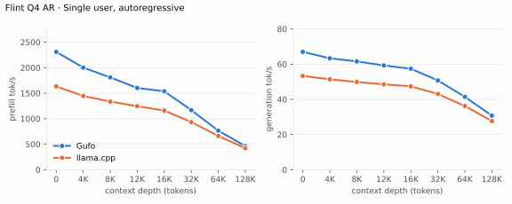
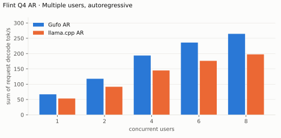
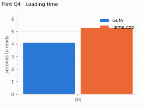
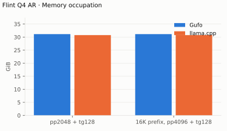

# Recursive Flint benchmarks

AMD Strix Halo `gfx1151`, 128 GB unified memory. Unsloth `UD-Q4_K_XL`
single-file GGUF. HTTP, greedy, seed 1, measured October 23, 2026 on the
`performance` power profile. Flint has no thinking
switch: on both servers the model opens `<think>` and spends all 128 generated
tokens reasoning; the timed scope counts every generated token. Both sides
are Nix builds: the production package at commit `526736b` and
`.#llama-cpp-flint-reference` (llama.cpp `970b51ce`, build 11827). Flint has
no speculative mode in Gufo or in this llama.cpp reference, so the card has no
speculative tables.

Positive gain favors Gufo.
[Quality and measurement details](QUALITY.md#benchmark-method) · [Model identities](artifacts/model-identities.json)

Both servers report identical prompt and cache counts at every depth (131,072:
frontiers one token apart). Completion hashes cover the streamed reasoning
and content. All 63 Gufo C1–C8 concurrency completions match its C1 output,
which also equals the single-user depth-0 completion.

## Single user, autoregressive

pp2048 / tg128; depth is the cached prefix in tokens.

<!-- bench:single-ar -->
| Flint Q4 AR Depth (tokens) | Gufo pp (tok/s) | llama.cpp pp (tok/s) | Gain | Gufo tg (tok/s) | llama.cpp tg (tok/s) | Gain |
| ---: | ---: | ---: | ---: | ---: | ---: | ---: |
| 0 | 2311.26 | 1633.17 | +41.5% | 67.01 | 53.35 | +25.6% |
| 4,096 | 2002.29 | 1447.11 | +38.4% | 63.36 | 51.40 | +23.3% |
| 8,192 | 1809.90 | 1336.09 | +35.5% | 61.58 | 49.87 | +23.5% |
| 12,288 | 1603.58 | 1246.08 | +28.7% | 59.28 | 48.55 | +22.1% |
| 16,384 | 1537.51 | 1159.57 | +32.6% | 57.40 | 47.41 | +21.1% |
| 32,768 | 1168.18 | 934.12 | +25.1% | 50.75 | 43.06 | +17.9% |
| 65,536 | 765.97 | 662.17 | +15.7% | 41.44 | 36.19 | +14.5% |
| 131,072 | 462.84 | 422.41 | +9.6% | 30.74 | 27.70 | +11.0% |
<!-- /bench -->

## Multiple users, autoregressive

Same pp2048 prose prompt as single-user d0, tg128, context 4096 per user.
Prefill every session before timed decoding; sum individual request decode
rates; mean of three measured cohorts per point (single-user rows: one warmed
sample).

<!-- bench:multi-ar -->
| Flint Q4 AR Users | Gufo AR (tok/s) | llama.cpp AR (tok/s) | Gain |
| ---: | ---: | ---: | ---: |
| 1 | 66.94 | 53.15 | +25.9% |
| 2 | 117.81 | 91.55 | +28.7% |
| 4 | 193.70 | 144.92 | +33.7% |
| 6 | 235.95 | 176.35 | +33.8% |
| 8 | 264.51 | 197.41 | +34.0% |
<!-- /bench -->

## Loading time

C1, capacity 262144, AR. Cold model file (`POSIX_FADV_DONTNEED`, zero resident
pages verified with `mincore`) to HTTP readiness; runtime libraries may be warm.

<!-- bench:loading -->
| Flint Q4 Target | Gufo ready (s) | llama.cpp ready (s) | Gain |
| --- | ---: | ---: | ---: |
| Q4 | 4.25 | 5.21 | +22.6% |
<!-- /bench -->

## Memory occupation

C1, AR, capacity 133121 on both servers; peak device-global HIP memory in use
during each workload, including 3.01 GiB already in use before either server
started (Gufo's own share: 28.1 GiB). Both servers
allocate KV for the full capacity before the measured requests, so neither
footprint grows with the prefix.

<!-- bench:memory -->
| Flint Q4 AR Workload | Gufo GiB | llama.cpp GiB | Gain |
| --- | ---: | ---: | ---: |
| pp2048 + tg128 | 31.15 | 30.77 | -1.2% |
| 16K prefix, pp4096 + tg128 | 31.15 | 30.77 | -1.2% |
<!-- /bench -->

